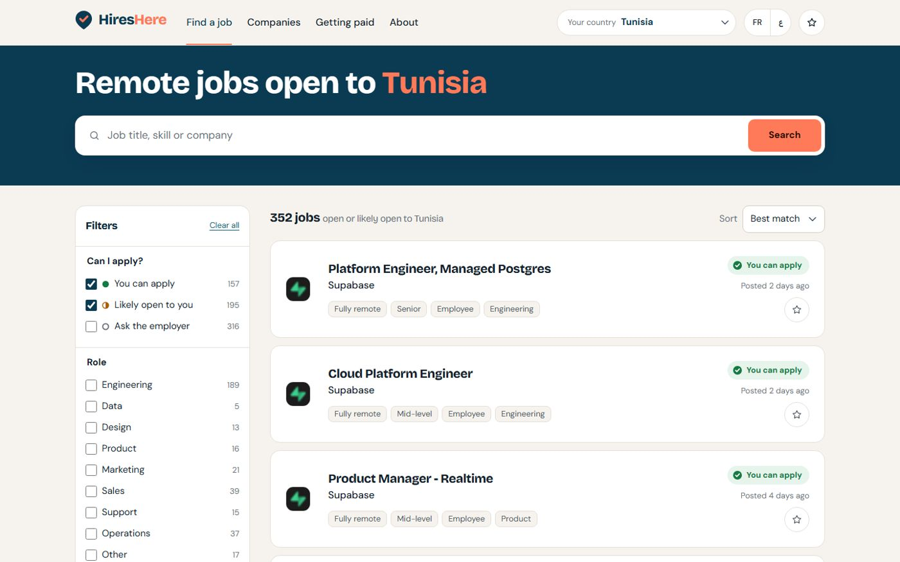
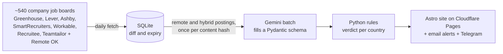

# HiresHere

**Remote jobs you can actually apply for from your country.** Every job gets a verdict for your country ("You can apply", "Likely open to you" or "Ask the employer") and the sentence from the posting that proves it.

**Live: [hireshere.app](https://hireshere.app)** · English, French and Arabic · 243 countries

[](https://hireshere.app/jobs)

## Why

Most "remote" jobs are remote only inside one country or region. The location rule is buried in the posting ("must be based in the EU", "US work authorization required", "UTC-5 to UTC+1"), so people outside the US and Europe waste hours on jobs they can't get. HiresHere reads every posting once and answers one question per country: can someone living here apply?

## How it works



1. **Fetch.** A GitHub Actions job reads each company's public job feed straight from its hiring system, keeps the employer's posting date, and expires jobs the day they disappear.
2. **Extract.** Each remote or hybrid posting is read once by `gemini-3.1-flash-lite` in batch mode, which fills a typed schema: remote type, allowed countries and regions, time zone window, work authorization, seniority, and an evidence quote. A quote that is not verbatim in the posting lowers the confidence.
3. **Decide.** Plain Python rules (`pipeline/classify/verdict.py`) turn one extraction into a verdict for each of 243 countries at export time, so adding a country costs no AI calls.
4. **Publish.** A static Astro site on Cloudflare Pages, job pages rendered by Pages Functions, D1 for sign-ups, daily email alerts (Resend) and Telegram channels.

## Numbers (11 October 2026)

| | |
|---|---|
| Jobs listed | 11,566 from 597 companies |
| Company boards tracked | 537 |
| Countries with a verdict | 243 |
| Cost to classify 4,563 new postings | $1.85 (Gemini batch) |
| Hosting | free tiers (GitHub Actions, Cloudflare Pages, D1) |

## Run it locally

Needs Python 3.12 and [uv](https://docs.astral.sh/uv/).

```
uv sync
uv run pytest -q
uv run python -m pipeline.run fetch --limit 20   # quick run against 20 boards
uv run python -m pipeline.run stats
uv run python -m pipeline.run classify --batch    # needs GEMINI_API_KEY
uv run python -m pipeline.run export
cd site && npm install && npx astro build
```

Copy `.env.example` to `.env` for keys and overrides.

## Layout

- `pipeline/connectors/`: one module per hiring system, each a pure `parse()` plus `fetch()`.
- `pipeline/db.py`: the SQLite schema and the diff rules (new, updated, expired).
- `pipeline/classify/`: schema, prompt and pre-filter, Gemini batch client, the per-country verdict.
- `pipeline/export.py`: search index and job detail shards for the site.
- `site/`: Astro site and Cloudflare Pages Functions.
- `docs/`: [spec](docs/SPEC.md), [roadmap](docs/ROADMAP.md), and [design decisions](docs/DECISIONS.md), each with its reasoning.

## Data and fair use

Jobs come only from public feeds that companies publish for their own careers pages, plus Remote OK's API, which allows reuse with credit. Every job links back to the original posting; the site never republishes full descriptions. Sites whose terms forbid it (LinkedIn, Indeed, Glassdoor and others) are never scraped. The company list builds on [remoteintech/remote-jobs](https://github.com/remoteintech/remote-jobs) and [kalil0321/ats-scrapers](https://github.com/kalil0321/ats-scrapers); see [data/CREDITS.md](data/CREDITS.md).

## Contributing

Issues and pull requests are welcome, especially new company boards (`data/boards.csv`), connectors for other hiring systems, and corrections to verdicts or translations. For a wrong verdict, open an issue with the job link and your country.

Built by [Aymen Jeddou](https://aymenjeddou.github.io).

## License

MIT, see [LICENSE](LICENSE). Third-party data keeps its own license: see [data/CREDITS.md](data/CREDITS.md).
